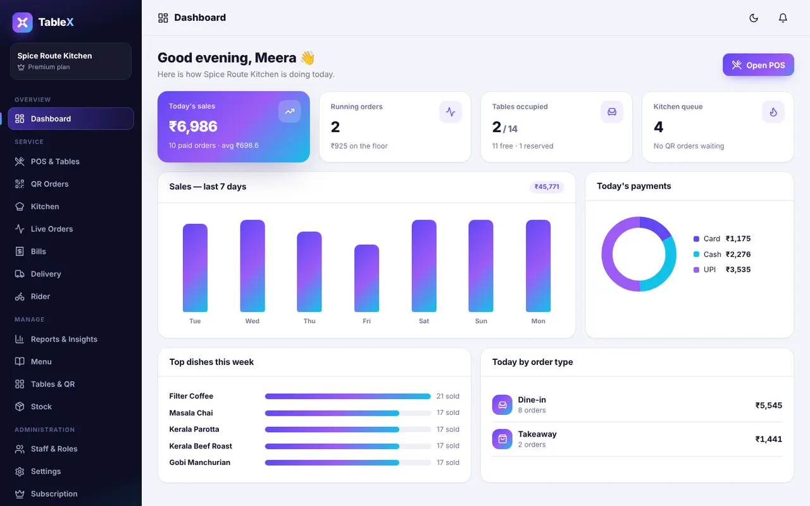
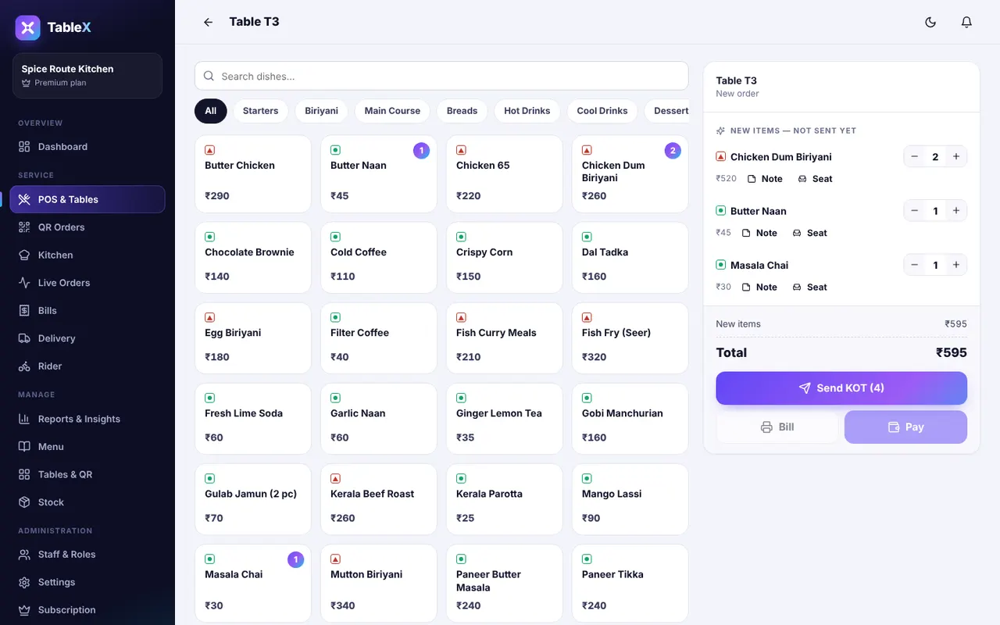
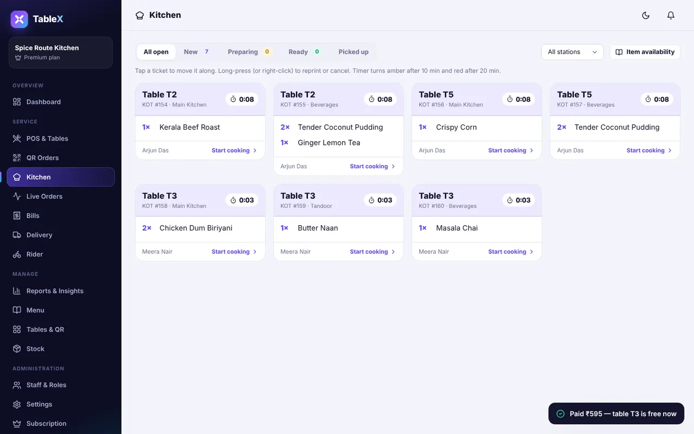
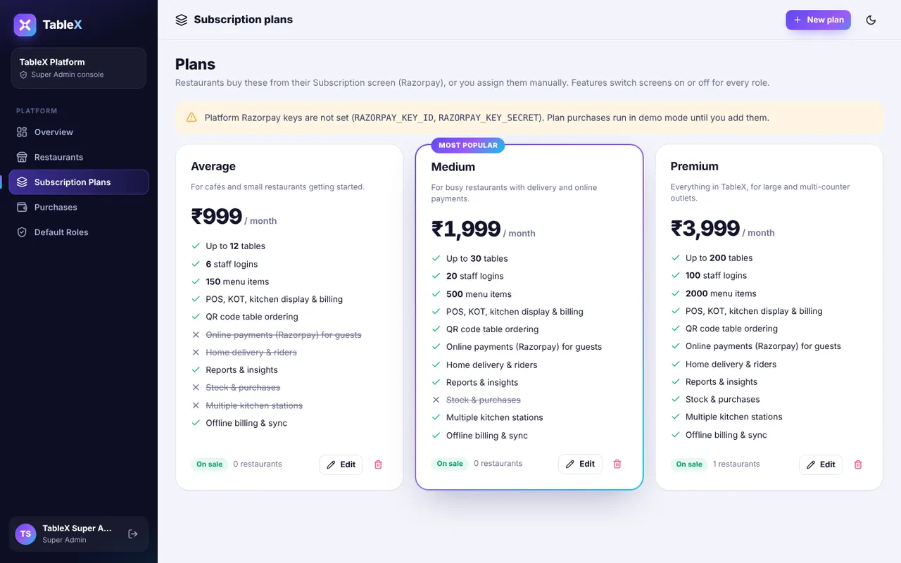
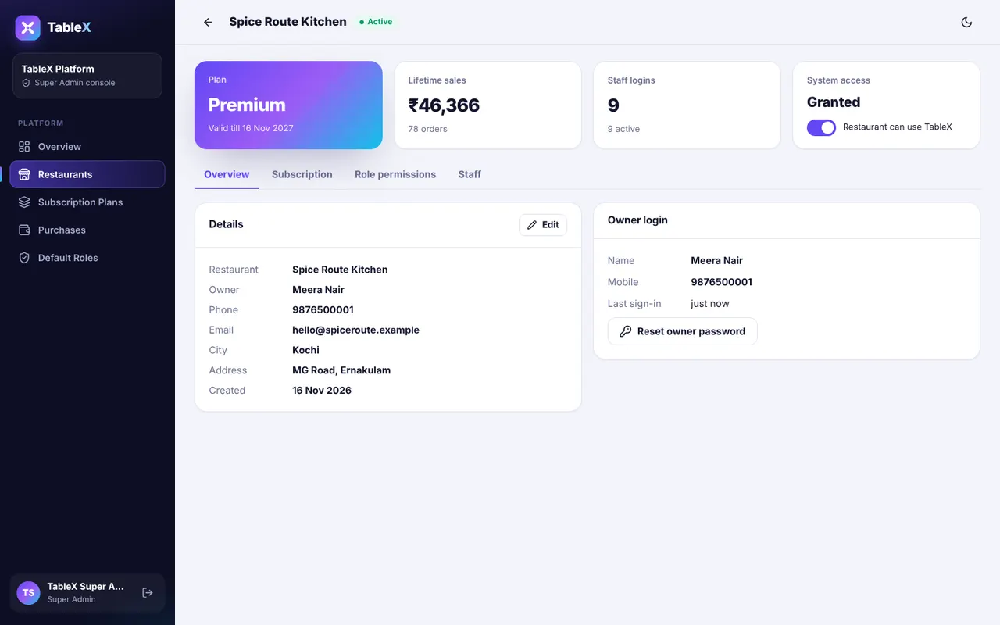

# TableX — Restaurant Management SaaS

TableX runs a restaurant from any phone or computer: tables, QR ordering, kitchen tickets (KOT), billing, payments,
delivery, stock and daily reports, sold to restaurants as subscription plans managed by a **Super Admin**.



| POS order screen | Kitchen display |
|---|---|
|  |  |

| Super Admin — plans | Super Admin — restaurant access & roles |
|---|---|
|  |  |

Guest QR menu, cart & order tracking, waiter POS and rider app on mobile:


---

## Quick start

Requirements: **Node.js 22.13+** (uses the built-in `node:sqlite`). There are **no npm dependencies** to install.

```bash
git clone https://github.com/jincyrajeevan0811/TableX.git
cd TableX
cp .env.example .env        # set SUPERADMIN_PASSWORD and (optionally) Razorpay keys
npm run seed                # optional: demo restaurant with staff, menu, tables and a week of sales
npm start                   # → http://localhost:8080
```

Use `npm run dev` for auto-restart while developing, and `npm test` to run the end-to-end API test suite.

### Logins

| Who | Mobile | Password |
|---|---|---|
| Super Admin | `9000000000` (from `SUPERADMIN_PHONE`) | `SUPERADMIN_PASSWORD` (default `ChangeMe@123` — change it!) |
| Demo Owner | `9876500001` | `Demo@123` |
| Demo Admin / Manager | `9876500002` / `9876500003` | `Demo@123` |
| Demo Captain (waiter) | `9876500004`, `9876500005` | `Demo@123` |
| Demo Cashier / Kitchen / Rider / Store keeper | `9876500006` / `07` / `08` / `09` | `Demo@123` |

Demo staff PINs for quick switching are `1111`, `2222` … `9999` (same order as above).

---

## Features

### Super Admin (platform)
- **Subscription plans** — create/edit plans (e.g. *Average*, *Medium*, *Premium*): monthly & yearly price, limits
  (tables, staff logins, menu items) and included features (QR ordering, online payments, delivery, reports, stock,
  multi-station kitchen, offline mode). Plans can be hidden from sale.
- **Onboard restaurants** — creates the restaurant, its Owner login and tables, then either starts a free trial,
  activates a paid plan (offline payment), or waits for the owner to buy online.
- **Grant / pause system access** per restaurant, **assign or extend plans** manually, reset the owner password.
- **Role-based permissions** — platform-wide defaults for every role, plus per-restaurant overrides.
- **Revenue overview** — MRR, lifetime revenue, live/lapsed restaurants, expiring plans, purchase history (CSV).

### Restaurant roles
| Role | What they can do (defaults — editable in *Staff & Roles*) |
|---|---|
| **Owner** | Everything. Can open any table, even one a waiter is using ("Opened as owner"). |
| **Admin** | Full restaurant administration (menu, staff, roles, settings, subscription, reports). |
| **Manager** | Runs the floor: orders, billing, discounts, cancellations, live orders, delivery, reports, menu, tables. |
| **Captain (waiter)** | Takes table orders, sends KOTs, accepts QR orders. |
| **Cashier** | Prints bills, takes payments (cash / UPI / card / split / Razorpay), gives discounts, reprints old bills. |
| **Kitchen** | Kitchen display — marks tickets Preparing → Ready → Picked up; marks items finished for the day. |
| **Rider** | Goes online, accepts deliveries, directions & call, verifies the customer's 4-digit code, collects COD. |
| **Store keeper** | Stock items, purchases, usage & wastage. |

Plan features are applied on top of role permissions, so a screen disappears for everyone if the plan does not include it.

### Daily operations
- **POS & tables** — colour-coded floor (Free, Occupied, Billed, Reserved, Cleaning), areas/rooms, table lock with the
  waiter's name, long-press to mark free/reserved/cleaning, move order to another table.
- **Orders** — search & category filters, notes ("less spicy"), seat numbers, **Send KOT** (only new items go to the
  kitchen, split per kitchen station), duplicate-entry warning ("Already added"), takeaway and home delivery.
- **Kitchen display** — live tickets with sound, timers turning amber/red, station filter, reprint/cancel.
- **Billing** — discounts (₹ or %), service charge, optional GST (CGST/SGST on the bill), round-off, split payments,
  change calculation, 80 mm receipt printing, copy bill for WhatsApp, Razorpay collection.
- **Bills** — every bill kept forever; search by bill no., table, phone or name; reprint.
- **Live orders** — every open order with kitchen state, waiter and age, auto-refreshing.
- **QR ordering** — printable QR code per table; guests browse the menu, order, call a waiter / ask for the bill /
  water, track their order and **pay online with Razorpay**. Orders wait in *QR Orders* until staff accept them.
- **Delivery** — customer details, delivery fee, auto-assign nearest free online rider or pick one, OTP-verified handover.
- **Reports & insights** — daily item sales (qty, orders, amount, discounts, net, cash/UPI/card split) with Print & CSV;
  sales trends, categories, busiest hours and staff performance.
- **Menu** — add/edit, availability toggle, bulk delete, categories, **CSV import** (`name, category, price, veg/non_veg[, station]`).
- **Staff & Roles** — one login per person; waiter/cashier logins work on one device at a time; 4-digit PIN quick switch.
- **Works offline** — the app shell is cached and KOTs are saved on the device while offline, then synced automatically
  (idempotent, so nothing is entered twice).
- **Light & dark themes**, responsive from phones to large counter screens.

---

## Razorpay setup

TableX uses Razorpay in two places:

1. **Plan purchases (platform account)** — set in `.env`:
   ```
   RAZORPAY_KEY_ID=rzp_live_xxx
   RAZORPAY_KEY_SECRET=xxxxxxxx
   RAZORPAY_WEBHOOK_SECRET=xxxxxxxx
   ```
2. **Guest & counter payments (each restaurant's own account)** — the owner enters their Key ID, Key Secret and
   (optionally) Webhook Secret in **Settings → Online payments**. Requires a plan with *Online payments*.

Flow: the server creates an Order via the Razorpay Orders API → the browser opens Razorpay Checkout → the server verifies
`HMAC_SHA256(order_id|payment_id, key_secret)` before marking anything as paid. Point a Razorpay webhook
(events `payment.captured`, `order.paid`) at `https://<your-domain>/api/webhooks/razorpay` so payments are applied even if
the browser closes; payments are applied exactly once.

Without keys, payments run in a clearly labelled **demo mode** so you can try every flow. Set `ALLOW_DEMO_PAYMENTS=false`
in production.

---

## Configuration (`.env`)

| Variable | Default | Purpose |
|---|---|---|
| `PORT` | `8080` | HTTP port |
| `APP_URL` | request host | Public URL used inside table QR codes — set this in production |
| `DB_FILE` | `data/tablex.db` | SQLite database file (back it up!) |
| `SUPERADMIN_NAME/PHONE/EMAIL/PASSWORD` | see `.env.example` | Super Admin created on first start |
| `RAZORPAY_KEY_ID/KEY_SECRET/WEBHOOK_SECRET` | empty | Platform Razorpay account |
| `ALLOW_DEMO_PAYMENTS` | `true` | Allow demo payments when keys are missing |
| `TRIAL_DAYS` | `14` | Free-trial length for newly onboarded restaurants |

## Deploying

Any host that runs Node 22 works (a VPS, Render, Railway, Fly.io, etc.). Run `npm start` behind HTTPS (Nginx / Caddy or
the platform's proxy), set `APP_URL`, keep `DB_FILE` on a persistent disk and back it up regularly.

## Project structure

```
server/
  app.js            HTTP server, router wiring, bootstrap (default plans + Super Admin)
  config.js         environment configuration
  seed.js           demo data
  lib/              db (node:sqlite), auth & sessions, permissions, orders engine, Razorpay, subscriptions
  routes/           auth, admin (Super Admin), restaurant (settings/staff/roles/dashboard), menu, tables,
                    orders (KOT/bill/pay/QR/live/bills), kitchen, delivery & rider, reports, inventory,
                    subscription (+ Razorpay webhook), public (guest QR API)
public/
  index.html        staff & Super Admin app (single-page, no build step)
  order.html        guest QR ordering page (/m/<table token>)
  css/app.css       TableX design system (light + dark)
  js/               app shell & router, API client with offline queue, UI kit, QR generator, pages/
tests/api.test.js   end-to-end API tests (node:test)
```

## Licences

Icons are from [Lucide](https://lucide.dev) (ISC licence). Everything else © TableX.
