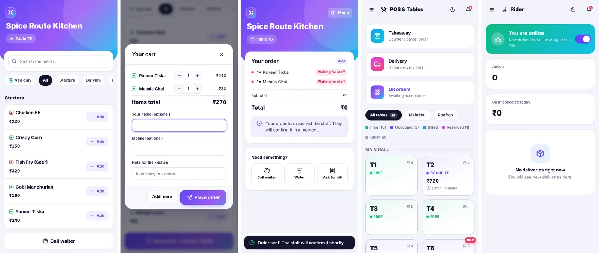

# TableX — Restaurant Management SaaS (Python · Django)

TableX runs a restaurant from any phone or computer: tables, QR ordering, kitchen tickets (KOT), billing, payments,
delivery, stock and daily reports, sold to restaurants as subscription plans managed by a **Super Admin**.

Built with **Django 5** — models, migrations, Django admin and a JSON API — plus a fast single-page web app served
through Django templates and static files.


| POS order screen | Kitchen display |
|---|---|
|  |  |

| Super Admin — plans | Super Admin — restaurant access & roles |
|---|---|
|  |  |

Guest QR menu, cart & order tracking, waiter POS and rider app on mobile:



---

## Quick start

Requirements: **Python 3.11+**.

```bash
git clone https://github.com/jincyrajeevan0811/TableX.git
cd TableX
python -m venv .venv
source .venv/bin/activate            # Windows: .venv\Scripts\activate
pip install -r requirements.txt
cp .env.example .env                 # set SUPERADMIN_PASSWORD, Razorpay keys, etc.
python manage.py migrate             # creates the database, default plans and the Super Admin
python manage.py seed_demo           # optional: demo restaurant with staff, menu, tables and a week of sales
python manage.py runserver           # → http://127.0.0.1:8000
```

Run the tests with `python manage.py test`.

### Logins

| Who | Mobile | Password |
|---|---|---|
| Super Admin | `9000000000` (`SUPERADMIN_PHONE`) | `SUPERADMIN_PASSWORD` (default `ChangeMe@123` — change it!) |
| Demo Owner | `9876500001` | `Demo@123` |
| Demo Admin / Manager | `9876500002` / `9876500003` | `Demo@123` |
| Demo Captain (waiter) | `9876500004`, `9876500005` | `Demo@123` |
| Demo Cashier / Kitchen / Rider / Store keeper | `9876500006` / `07` / `08` / `09` | `Demo@123` |

Demo staff PINs for quick switching are `1111`, `2222` … `9999` (same order as above).

The Super Admin can also open **Django admin** at `/django-admin/` with the same mobile number and password, to browse
the raw data.

---

## Features

### Super Admin (platform)
- **Subscription plans** — create/edit plans (e.g. *Average*, *Medium*, *Premium*): monthly & yearly price, limits
  (tables, staff logins, menu items) and included features (QR ordering, online payments, delivery, reports, stock,
  multi-station kitchen, offline mode). Plans can be hidden from sale.
- **Onboard restaurants** — creates the restaurant, its Owner login and tables, then starts a free trial, activates a
  paid plan (offline payment), or waits for the owner to buy online with Razorpay.
- **Grant / pause system access** per restaurant, **assign or extend plans**, reset the owner password.
- **Role-based permissions** — platform-wide defaults for every role plus per-restaurant overrides.
- **Revenue overview** — MRR, lifetime revenue, live/lapsed restaurants, expiring plans, purchase history (CSV).

### Restaurant roles
| Role | What they can do (defaults — editable in *Staff & Roles*) |
|---|---|
| **Owner** | Everything. Can open any table, even one a waiter is using ("Opened as owner"). |
| **Admin** | Full restaurant administration (menu, staff, roles, settings, subscription, reports). |
| **Manager** | Runs the floor: orders, billing, discounts, cancellations, live orders, delivery, reports, menu, tables. |
| **Captain (waiter)** | Takes table orders, sends KOTs, accepts QR orders. |
| **Cashier** | Prints bills, takes payments (cash / UPI / card / split / Razorpay), gives discounts, reprints old bills. |
| **Kitchen** | Kitchen display — Preparing → Ready → Picked up; marks items finished for the day. |
| **Rider** | Goes online, accepts deliveries, directions & call, verifies the customer's 4-digit code, collects COD. |
| **Store keeper** | Stock items, purchases, usage & wastage. |

Plan features apply on top of role permissions, so a screen disappears for everyone if the plan does not include it.

### Daily operations
- **POS & tables** — colour-coded floor (Free, Occupied, Billed, Reserved, Cleaning), areas, table lock with the
  waiter's name, long-press to mark free/reserved/cleaning, move an order to another table.
- **Orders** — search & categories, notes, seat numbers, **Send KOT** (only new items, split per kitchen station),
  "Already added" duplicate warning, takeaway and home delivery.
- **Kitchen display** — live tickets with sound, amber/red timers, station filter, reprint/cancel.
- **Billing** — discounts (₹ or %), service charge, optional GST (CGST/SGST), round-off, split payments, change
  calculation, 80 mm receipt printing, copy bill for WhatsApp, Razorpay collection.
- **Bills** — kept forever; search by bill no., table, phone or name; reprint.
- **Live orders**, **QR ordering** (call waiter, ask for bill, order tracking, pay online), **delivery** with
  auto-assign and OTP handover, **reports** (daily item sales with Print/CSV, trends, categories, busy hours, staff),
  **menu** (CSV import, availability), **stock**, **staff** (one device per waiter login, 4-digit PIN switch).
- **Works offline** — the app shell is cached and KOTs are saved on the device while offline, then synced
  automatically (idempotent, so nothing is entered twice).
- **Light & dark themes**, responsive from phones to large counter screens.

---

## Razorpay

1. **Plan purchases (platform account)** — in `.env`: `RAZORPAY_KEY_ID`, `RAZORPAY_KEY_SECRET`, `RAZORPAY_WEBHOOK_SECRET`.
2. **Guest & counter payments (each restaurant's own account)** — the owner enters Key ID, Key Secret and (optionally)
   Webhook Secret in **Settings → Online payments** (needs a plan with *Online payments*).

The server creates an Order with the Razorpay Orders API, the browser opens Razorpay Checkout, and the server verifies
`HMAC_SHA256(order_id|payment_id, key_secret)` before anything is marked paid. Add a webhook in the Razorpay dashboard
(events `payment.captured`, `order.paid`) pointing to `https://<your-domain>/api/webhooks/razorpay`; payments are
applied exactly once even if both the browser and the webhook report them.

Without keys, payments run in a clearly labelled **demo mode**. Set `ALLOW_DEMO_PAYMENTS=false` in production.

---

## Configuration (`.env`)

| Variable | Default | Purpose |
|---|---|---|
| `DJANGO_SECRET_KEY` | dev key | **Set a long random value in production** |
| `DJANGO_DEBUG` | `true` | `false` in production |
| `DJANGO_ALLOWED_HOSTS` | `*` | Comma-separated host names |
| `DJANGO_CSRF_TRUSTED_ORIGINS` | – | e.g. `https://app.tablex.in` (for Django admin behind HTTPS) |
| `DB_ENGINE` | `sqlite` | `postgres` to use PostgreSQL (`DB_NAME`, `DB_USER`, `DB_PASSWORD`, `DB_HOST`, `DB_PORT`) |
| `DB_FILE` | `db.sqlite3` | SQLite file |
| `APP_URL` | browser address | Public URL used inside table QR codes |
| `SUPERADMIN_NAME/PHONE/EMAIL/PASSWORD` | see `.env.example` | Super Admin created on first `migrate` |
| `RAZORPAY_KEY_ID/KEY_SECRET/WEBHOOK_SECRET` | empty | Platform Razorpay account |
| `ALLOW_DEMO_PAYMENTS` | `true` | Allow demo payments when keys are missing |
| `TRIAL_DAYS` | `14` | Free-trial length for newly onboarded restaurants |

## Deploying

```bash
pip install -r requirements.txt
export DJANGO_DEBUG=false DJANGO_SECRET_KEY=... DJANGO_ALLOWED_HOSTS=app.example.com APP_URL=https://app.example.com
python manage.py migrate
python manage.py collectstatic --noinput
gunicorn tablex.wsgi -b 0.0.0.0:8000 -w 3
```

Put it behind HTTPS (Nginx, Caddy or your platform's proxy). Static files are served by WhiteNoise. For more than one
server, use PostgreSQL (`DB_ENGINE=postgres`). Works on any Python host — a VPS, Render, Railway, Fly.io, PythonAnywhere, etc.

## Project structure

```
manage.py
tablex/                 Django project: settings (env-driven), urls, wsgi/asgi
core/                   the TableX app
  models.py             Plan, Restaurant, Subscription, User (custom, phone login), AuthSession, RolePermission,
                        DiningTable, Category, MenuItem, Order, Kot, OrderItem, Payment, GatewayOrder, RiderStatus,
                        Notification, InventoryItem, StockMove, Counter
  migrations/           database migrations
  admin.py              Django admin registration
  bootstrap.py          default plans + Super Admin (runs after migrate)
  lib/                  auth & sessions, permissions, order engine, Razorpay, subscriptions, HTTP/JSON helpers
  api/                  JSON endpoints: auth, admin (Super Admin), restaurant, menu, tables, orders, kitchen,
                        delivery, reports, inventory, subscription (+ webhook), public (guest QR)
  urls.py, pages.py     URL routes and the HTML pages
  templates/tablex/     index.html (staff & Super Admin app), order.html (guest QR menu)
  static/               css, js (app, pages, offline queue, QR generator), assets, service worker
  management/commands/seed_demo.py
  tests/test_api.py     end-to-end API tests
e2e/ui_smoke.py         browser test (Playwright) used by CI
.github/workflows/ci.yml  runs checks, tests and the browser test on every push
```

The earlier Node.js implementation is kept on the `node-version` branch.

## Licences

Icons are from [Lucide](https://lucide.dev) (ISC licence). Everything else © TableX.
